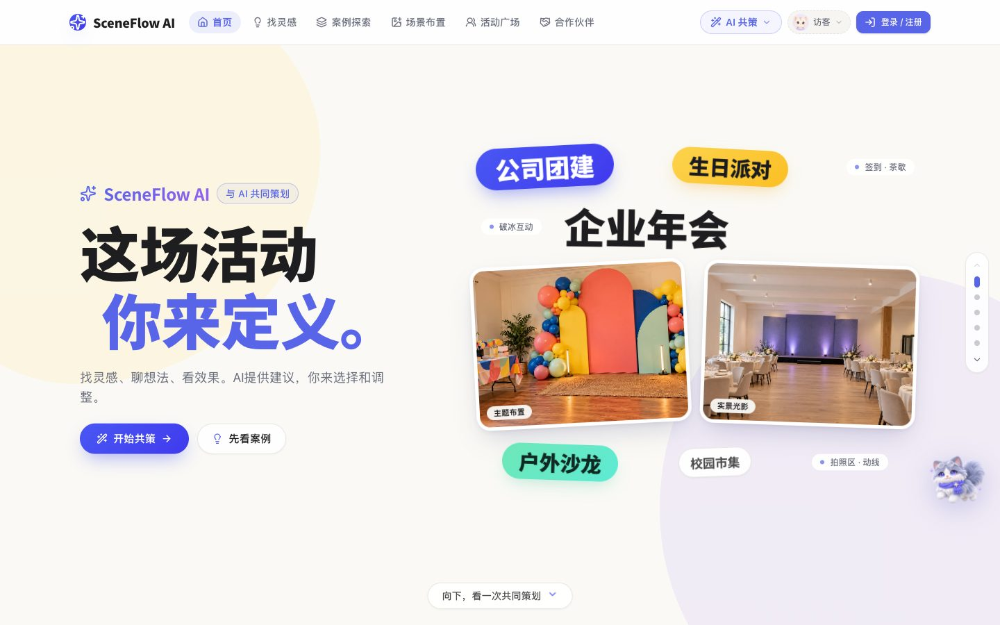
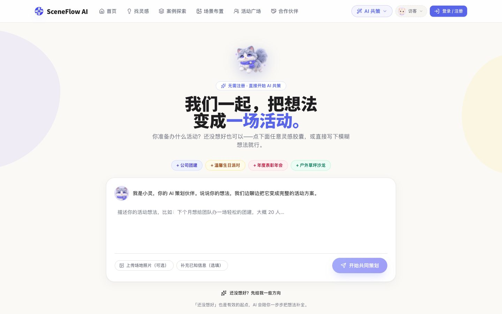
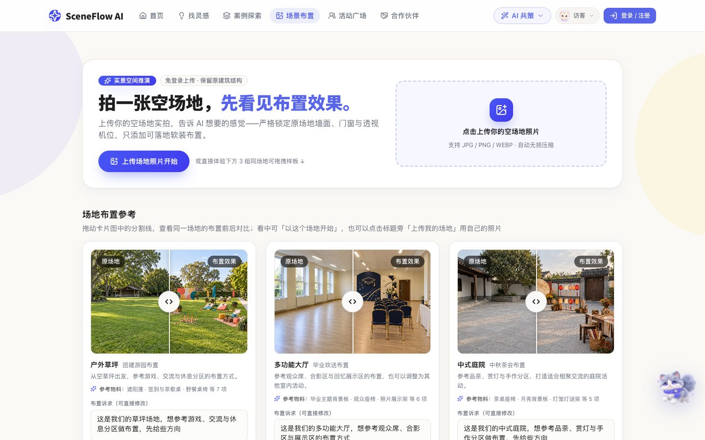
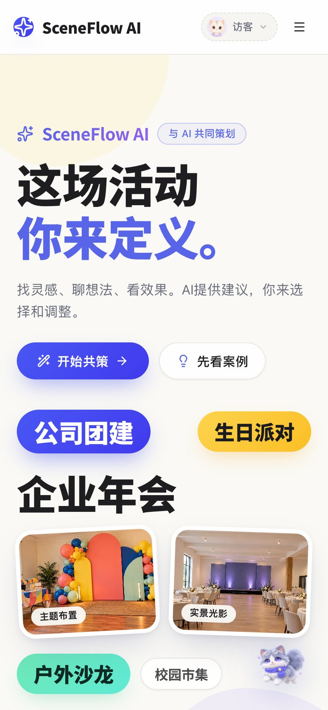
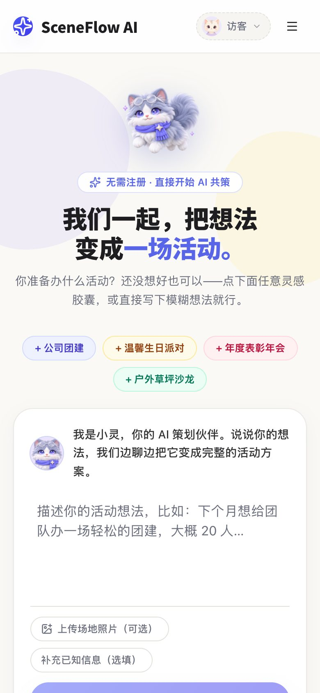
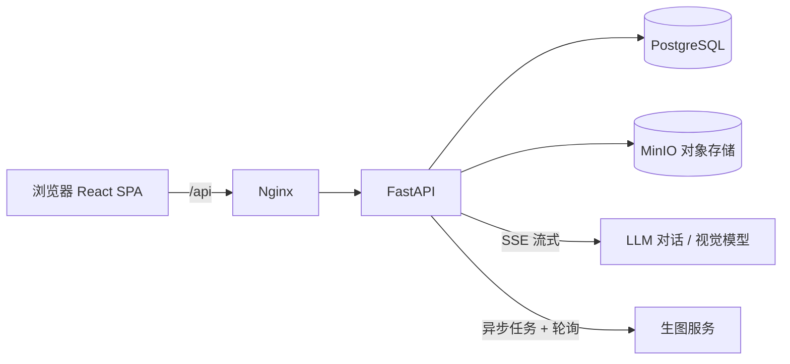

# SceneFlow AI

[](https://github.com/AiHyo/scene-flow/actions/workflows/ci.yml)
[](./LICENSE)

> 和 AI 一起策划一场活动：多轮对话梳理需求，生成方案、流程、预算与文案；上传一张空场地照片，在**保留原有建筑结构**的前提下生成布置效果图。



| AI 共同策划 | 场地布置前后对比 |
|---|---|
|  |  |

<p>
  
  
</p>

## 核心功能

- **AI 协同策划工作台**：流式多轮对话；按需生成活动方向、主题、完整方案（流程 / 预算 / 物料 / 任务）与邀请函、主持词等文案；对话中提出的跨模块修改以「调整建议卡」呈现，确认后才写入方案。
- **场地识别与布置效果图**：上传场地照片，先由视觉模型读取画面内可见的空间结构，再以原图为编辑目标生成布置图，约束只新增可移动物件、不改墙体门窗与机位。
- **预算与事实约束**：预算结余 / 超支按有符号差值计算；提示词约束模型把未确认的人数、价格、负责人标注为「建议，待确认」，不编造人名与商家。
- **案例、灵感与资源库**：整套案例一键复制到工作台继续改；灵感布置参考与物料资源。
- **活动广场**：动态发布、多图上传、点赞与评论。
- **访客即用**：无需注册即可开始策划；登录后可选择把访客期间的项目归入账号。

## 技术栈

| 层 | 技术 |
|---|---|
| 前端 | React 18、TypeScript、Vite、Tailwind CSS、Radix UI、GSAP |
| 后端 | Python、FastAPI、SQLAlchemy 2.0（async）、Alembic、Pydantic v2 |
| AI | OpenAI 兼容协议（对话 / 视觉）、`/v1/images/edits` 或可灵 Omni（生图） |
| 基础设施 | PostgreSQL 17、MinIO（S3 兼容）、Nginx、Docker Compose |
| 工程 | pnpm、tsgo 类型检查、Biome、ast-grep 自定义规则、GitHub Actions |

## 架构



- 前端只调用自有后端，模型密钥只存在于服务端环境变量。
- 生图与识图为异步任务：提交后返回任务 ID，前端轮询结果，生成的图片转存到 MinIO，避免上游临时链接过期。

## 快速开始

### 方式一：Docker Compose 一键启动

```bash
cp .env.example .env     # 按需填写 LLM_API_KEY 等配置
docker compose up -d --build
```

访问 <http://127.0.0.1:8080>，后端 API 文档在 <http://127.0.0.1:8000/docs>。

### 方式二：本地开发

需要 Node.js 24+、pnpm 12、Python 3.9+、Docker（用于数据库与对象存储）。

```bash
# 1. 启动 PostgreSQL 与 MinIO
docker compose up -d postgres minio

# 2. 启动后端
cd backend
python3 -m venv .venv
.venv/bin/pip install -e .
.venv/bin/alembic upgrade head
.venv/bin/uvicorn app.main:app --reload --port 8000

# 3. 启动前端（仓库根目录）
pnpm install
pnpm dev --host 127.0.0.1
```

前端地址 <http://127.0.0.1:5173>，`/api/*` 自动代理到 `127.0.0.1:8000`。

### 环境变量

| 变量 | 说明 |
|---|---|
| `LLM_BASE_URL` / `LLM_API_KEY` / `LLM_MODEL` / `LLM_VISION_MODEL` | OpenAI 兼容协议的对话与识图模型 |
| `IMG_GEN_PROVIDER` / `IMG_GEN_MODEL` | 生图配置，默认 `openai`（`/v1/images/edits`）；未单独设置 `IMG_GEN_BASE_URL` / `IMG_GEN_API_KEY` 时复用 `LLM_*`；设为 `kling` 时需填写可灵端点与密钥 |
| `JWT_SECRET` | 生产环境务必替换为 32 位以上随机字符串 |

完整列表见 [`.env.example`](./.env.example)。目前 AI 相关功能需要配置可用的模型密钥；无密钥的演示模式正在开发中（见路线图）。

## 项目结构

```
├── backend/          # FastAPI 服务：routers → services → models，providers 封装模型调用，storage 封装 MinIO
│   └── alembic/      # 数据库迁移
├── src/
│   ├── pages/        # 路由页面（首页、共策、工作台、场景布置、案例、广场等）
│   ├── components/   # 业务组件与 ui/ 基础组件
│   ├── services/     # API 调用、AI 编排、预算计算、方案补丁等领域逻辑
│   └── data/         # 案例、灵感、合作资源等预置数据
├── docker/           # Nginx 配置
├── .rules/           # ast-grep 自定义 lint 规则
└── .trellis/         # AI 协作开发的规格、任务与开发日志（见下文）
```

## 常用命令

```bash
pnpm lint     # tsgo 类型检查 + Biome + ast-grep 规则 + Tailwind 校验 + 构建冒烟测试
pnpm build    # 生产构建
```

## 路线图

- [ ] **AI 编排后端化**：提示词与模式编排从前端迁到后端，结构化输出 + Pydantic 校验，Provider 抽象
- [ ] **无密钥演示模式**：内置 Mock Provider，clone 后无需任何 API key 即可体验完整流程
- [ ] **离线评测**：固定用例集校验输出结构与业务规则（预算方向、零新增采购、不编造人名等），在 CI 中运行
- [ ] **后端安全加固**：外部 URL 抓取白名单、AI 任务持久化与归属校验、按用户限流、后端测试
- [ ] **前端性能**：路由懒加载、字体与图片瘦身

## AI 协作开发方式

本项目以 AI 编程助手为主要开发工具，按「规格 → 任务 → 实现 → 检查」的流程推进：

- 每项改动先在 [`.trellis/tasks/`](./.trellis/tasks) 中建立任务，写明需求（`prd.md`）、技术设计（`design.md`）与实施计划（`implement.md`），评审通过后才进入实现。
- 实现后统一经过 `pnpm lint` 等检查，再按任务提交；已完成的任务归档在 `.trellis/tasks/archive/`。
- `.claude/`、`.cursor/`、`.codex/` 等目录是同一套工作流在不同 AI 工具中的配置。

## License

[MIT](./LICENSE)。第三方素材来源见 [CREDITS.md](./CREDITS.md)。
